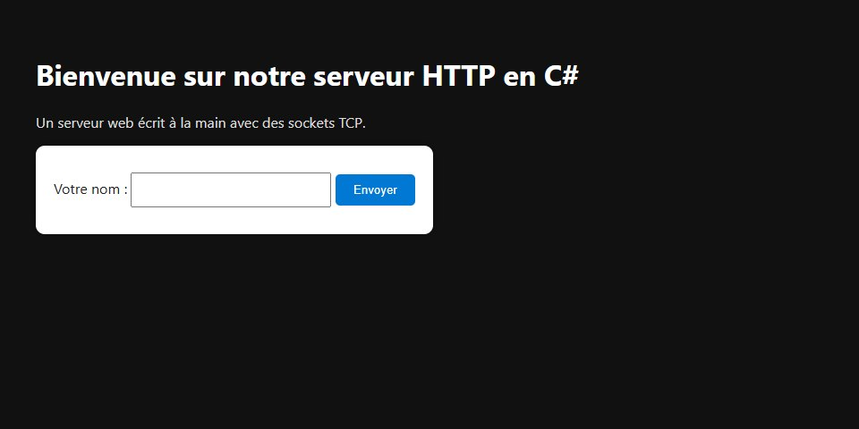
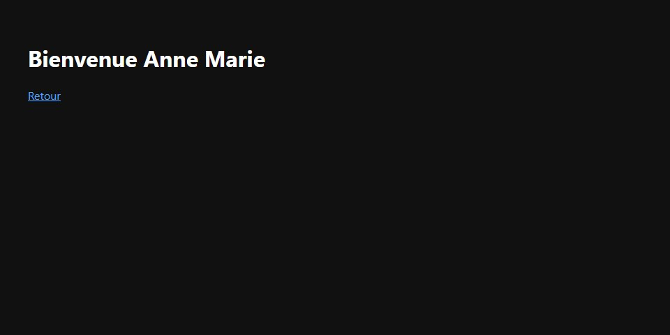

# HTTP Server in C#


A small HTTP/1.1 web server written from scratch in C#, directly on top of TCP sockets (`System.Net.Sockets`), with no web framework. It parses requests by hand, serves static files, handles form posts, keeps sessions with cookies, and compresses responses.

| Home page | Response to a form post |
| --- | --- |
|  |  |

## Features

- **Hand-written HTTP parsing.** Request line, headers (case-insensitive), and body read according to `Content-Length`.
- **Static files.** Served from `wwwroot/` with the right `Content-Type` (HTML, CSS, JS, JSON, images, and more). `404` for missing files and `403` for any path that tries to leave `wwwroot/`.
- **`GET` and `POST`.** A form on the home page posts to `/formulaire`; the server answers with a greeting page.
- **Sessions.** A `sessionId` cookie (`HttpOnly`) links each visitor to server-side data kept in memory.
- **Compression.** Gzip or Brotli, chosen from the client's `Accept-Encoding` header.
- **One thread per connection**, with a read timeout so idle connections don't pile up.
- **Safe output.** Visitor input is HTML-encoded before it is placed in a page.
- **Optional custom header.** Set the `X_STUDENT_ID` environment variable to add an `X-Etudiant-ID` header to every response.

## Run it

You need the [.NET 8 SDK](https://dotnet.microsoft.com/download).

```bash
git clone https://github.com/Gothrick/C-_HTTP_Server.git
cd C-_HTTP_Server
dotnet run --project src/HttpServer
```

Open <http://localhost:8088>. The port is 8088 by default; change it with an argument or the `PORT` variable:

```bash
dotnet run --project src/HttpServer -- 9000
```

The static files in `src/HttpServer/wwwroot/` are copied next to the executable at build time, so the server works from any folder.

### Try it with curl

```bash
curl -i http://localhost:8088/                          # the home page, plus a Set-Cookie header
curl -i -H "Accept-Encoding: gzip" http://localhost:8088/   # Content-Encoding: gzip
curl -i -d "nom=Anne+Marie" http://localhost:8088/formulaire # POST: "Bienvenue Anne Marie"
curl -i --path-as-is http://localhost:8088/../../README.md   # 403 Forbidden
```

## How it works

```text
src/HttpServer/
  Program.cs          Entry point: reads the port and starts the server
  HttpServer.cs       Accepts connections, one thread per client; routing, static files, form handling
  HttpRequete.cs      Parses a request from the stream (request line, headers, body, cookies)
  HttpResponse.cs     Builds and writes a response (status line, headers, body)
  GestionSession.cs   Finds or creates a session from the cookie
  Session.cs          Per-visitor data
  Compresseur.cs      Gzip and Brotli compression
  wwwroot/            The static site that is served
tests/HttpServer.Tests/   Unit tests and integration tests against a real server
```

Request flow: accept the connection, parse the request, find or create the session, route it (`GET` serves a file, `POST /formulaire` handles the form), compress the body if the client allows it, write the response, close the connection.

## Tests

```bash
dotnet test
```

27 xUnit tests: unit tests for the parser, compression, and form decoding, plus integration tests that start the real server on a free port and send it raw requests (status codes, content types, gzip and Brotli, sessions, HTML encoding, path traversal).

## Limits

This is a learning project, not a production server. It supports only `GET` and `POST`, answers one request per connection (`Connection: close`, no keep-alive), keeps sessions in memory (lost on restart), and has no TLS.

## About this project

The server started as a networking course lab at Cégep de Saint-Jean-sur-Richelieu. Since the original submission it has been reorganized into a solution with tests, and these problems were fixed:

- Path traversal: `GET /../file` could read files outside `wwwroot/`.
- Reflected HTML in the greeting page (the visitor's name is now encoded).
- Response lines ended with the OS line ending instead of the CRLF that HTTP requires.
- The cookie helper had inverted logic (and was unused), and header names were matched case-sensitively.
- POST bodies split across several TCP reads were truncated.
- A missing form field crashed the request, and `+` in form values was not decoded.
- The server depended on the working directory, and a student number was hard-coded in a response header (now the optional `X_STUDENT_ID` variable).
